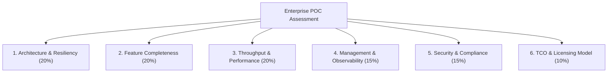

# Enterprise IT & Cybersecurity Product Reviews

[](https://github.com/febriyansyah-id/PRODUCT-REVIEWS)
[](index.html)
[-blue.svg)](https://github.com/febriyansyah-id)
[](#)
[](LICENSE)

> **Enterprise Technology Evaluation Hub**: Rigorous, vendor-neutral product evaluations, Proof-of-Concept (POC) benchmarks, architecture assessments, and sizing guidelines across Enterprise Datacenter Infrastructure, Campus & DC Networking, Next-Gen Cybersecurity, and Cloud Platforms.  
> **Evaluator**: **Febriyansyah** — Senior IT Cybersecurity & Infrastructure Leader | Enterprise Presales Specialist | MTI Scholar

---

## 🖥️ Interactive Product Comparator & Review Hub

An interactive **Product Review & POC Matrix Command Center** is built right into this repository:

👉 **Open [`index.html`](index.html) in your browser** to launch the interactive evaluation console:
- 🔍 **Live Search & Domain Filter**: Real-time filtering across Datacenter, Networking, Cybersecurity, and Cloud products.
- 📊 **Scoring Gauges & Radar Visualizer**: Visual side-by-side technical scoring comparison across 6 enterprise criteria.
- 📋 **POC Test-Case Inspector**: Review pass/fail telemetry, throughput metrics, and failover latency.
- 💡 **Architectural Recommendation Engine**: Instant fit-gap analysis for Banking, High-Throughput Enterprises, and SMEs.

---

## 🏛️ Structured Evaluation Pillars

```text
PRODUCT-REVIEWS/
├── 💾 01-INFRASTRUCTURE-DATACENTER/  # Server/HCI, SAN/NAS, Backup, Disaster Recovery & Storage Pools
├── 🌐 02-NETWORK-CONNECTIVITY/       # Core/Spine Switches, Enterprise Wi-Fi, SD-WAN & ADC Load Balancers
├── 🛡️ 03-CYBERSECURITY-SOLUTIONS/     # NGFW, EDR/XDR, SIEM/SOAR, Privileged Access Management (PAM)
├── ☁️ 04-CLOUD-PLATFORM-VIRT/        # Cloud Platforms, Zero Trust SASE, Container Platforms (OpenShift/K8s)
├── 📋 templates/                     # Standardized Presales POC Evaluation Template & Scorecard
├── 🌐 index.html                     # Standalone Interactive Evaluation Console (Tailwind CSS + Chart.js)
└── 📖 README.md                      # Master directory & evaluation catalog
```

---

## 📑 Curated Product Review Catalog

| Category | Product / Solution | Vendor | Focus & Architecture | Overall Score | Review Document |
| :--- | :--- | :--- | :--- | :---: | :--- |
| **01. Datacenter** | **Nutanix AHV vs Proxmox VE** | Nutanix / Proxmox | Enterprise HCI vs Open-Source KVM Clustering for Mission-Critical Banking | **9.4 / 10** | [Read Review 📄](01-INFRASTRUCTURE-DATACENTER/nutanix-ahv-vs-proxmox-ve-enterprise-poc.md) |
| **02. Networking** | **Cisco Catalyst 9300 vs Aruba CX 6300** | Cisco / Aruba (HPE) | Campus Access/Core Switching, Stacking, Telemetry & PoE+ Budget Analysis | **9.2 / 10** | [Read Review 📄](02-NETWORK-CONNECTIVITY/cisco-catalyst-9300-vs-aruba-cx-6300.md) |
| **03. Security** | **FortiGate NGFW vs Palo Alto PAN-OS** | Fortinet / Palo Alto | Enterprise Perimeter Defense, SSL Inspection, IPS Throughput & Zero-Day Sandboxing | **9.6 / 10** | [Read Review 📄](03-CYBERSECURITY-SOLUTIONS/fortigate-vs-palo-alto-enterprise-ngfw.md) |
| **04. Cloud & SASE**| **Cloudflare Zero Trust vs Traditional VPN** | Cloudflare | Identity-Aware Access, Micro-segmentation & Remote Workforce Security | **9.3 / 10** | [Read Review 📄](04-CLOUD-PLATFORM-VIRT/cloudflare-zero-trust-access-vs-traditional-vpn.md) |

---

## 📐 Enterprise POC Evaluation Methodology

Every product reviewed in this repository undergoes a rigorous 6-point evaluation matrix:



1. **Architecture & Resiliency (20%)**: High Availability (HA) failover speed, distributed state, single-point-of-failure (SPOF) elimination.
2. **Feature Completeness (20%)**: Out-of-the-box enterprise capabilities, API extensibility, third-party SIEM/Syslog integrations.
3. **Throughput & Performance (20%)**: Real-world load testing, latency under 80%+ capacity, IOPS and resource consumption.
4. **Management & Observability (15%)**: Intuitive Web GUI, centralized multi-cluster orchestrator, CLI usability, and SNMP/telemetry hooks.
5. **Security & Regulatory Compliance (15%)**: RBAC granular permissions, MFA integration, TLS 1.3 encryption, audit trails for regulatory compliance (OJK/BI/PCI-DSS).
6. **TCO & Licensing Model (10%)**: Transparency of subscription/perpetual licenses, hidden hardware add-on costs, long-term support (LTS) roadmap.

---

## 🚀 Adding New Reviews

To maintain quality and consistency, all contributors or presales engineers should use the standardized template:

```bash
# Copy template to target domain
cp templates/PRODUCT_REVIEW_TEMPLATE.md 03-CYBERSECURITY-SOLUTIONS/my-new-product-review.md
```

Follow the checklist defined in [`templates/PRODUCT_REVIEW_TEMPLATE.md`](templates/PRODUCT_REVIEW_TEMPLATE.md).

---

<div align="center">
  <sub>Maintained by <strong>Febriyansyah</strong> • IT Cybersecurity & Infrastructure Solution Leader</sub>
</div>
